# P0ppy: architecture

An AI on-call engineer for the OpenTelemetry demo. An alert starts an agent that chooses which
read-only tool to call next. Every observation is registered as evidence with an ID. Checkpoint 1 delivered a validated **symptom summary**: affected services, anomalies with numbers, the suspected
origin, and the evidence IDs behind each claim. Checkpoint 2 delivers the validated **diagnosis and remediation plan**:
root causes, standard fault classification, confidence score, cited evidence details and allowlisted runbook remedies.
Day 2 adds the **human approval gate, execution through our Action API, recovery verification with rollback, and the
incident report with a draft postmortem**.

```mermaid
flowchart LR
    AL["Alert JSON<br/>detector.py: calibrated per-service limits (no LLM)<br/>or manual / organiser"] --> AG

    subgraph AG["agent/run.py: tool-calling loop (Claude, Gemini or Groq; max 10 steps, kill switch)"]
        direction TB
        LLM["LLM picks the next tool<br/>from what it has found so far"]
    end

    AG -->|get_service_health, get_metric| PROM[("Prometheus<br/>span metrics, container,<br/>runtime metrics")]
    AG -->|find_error_traces| JAE[("Jaeger<br/>deepest failing span,<br/>call chain")]
    AG -->|search_logs| LOGS[("docker logs<br/>grouped patterns")]
    AG -->|get_deploy_history| INS[("docker inspect / stats<br/>state, restarts, OOM,<br/>start/stop times")]

    PROM & JAE & LOGS & INS --> REG[("evidence registry<br/>E1, E2, ...")]
    REG -->|small summaries + IDs| AG
    AG -->|submit_diagnosis| VAL["validator<br/>drops claims citing<br/>unknown evidence IDs"]
    REG --> VAL
    VAL --> DX["DIAGNOSIS & PLAN<br/>root causes, fault class, confidence,<br/>allowlisted action, human approval<br/>runs/&lt;timestamp&gt;.json"]

    DX --> RV["reviewer (optional, off by default)<br/>can only lower confidence"]
    RV --> AP{"human approval per step<br/>dry run by default"}
    AP -->|yes| KS{"kill switch<br/>checked by agent and API"}
    KS -->|clear| AC["actionapi/: localhost, token,<br/>allowlist, cooldown, idempotency,<br/>audit log"]
    AC --> DEMO[("OpenTelemetry demo<br/>restart or Locust throttle")]
    DEMO --> VE["verify<br/>container, spans, metrics vs baseline"]
    VE -->|recovered| RE["report + draft postmortem<br/>timeline, evidence, prevention"]
    VE -->|not recovered| RB["rollback if the step has one,<br/>then escalate"]
    AP -->|no| ESC["escalate to a human<br/>findings, optional email"]
    KS -->|on| ESC
    DX -->|low confidence or no allowlisted fix| ESC
    RB --> ESC
    ESC --> RE
```



## How it works
- **Sources.** Every tool reads through one interface. `live` (the default) uses Prometheus,
  Jaeger and the docker CLI. `bundle` replays a recorded live run. `test` uses JSON fixtures shaped
  exactly like those API responses. It only reads `tests/fixtures/<scenario>/` and only runs when
  `--test` is passed explicitly; the environment cannot select it. Every report (run file, summary,
  tool output, baseline) records `source` and `source_detail`, and test runs are saved as
  `runs/<ts>-test.json`. Baselines are captured live only, and a live run ignores any baseline
  that was not.
- **Small results.** Tools return summarised dicts of at most about 2 KB: worst services first,
  grouped log patterns, the trace origin, never raw dumps.
- **Evidence.** Each tool registers what it saw and returns IDs. Missing signals count too, such
  as "no recent payment traces". The summary may cite only those IDs; anything else is dropped
  and reported.
- **Origin, not the loudest victim.** Trace analysis follows the call chain to the deepest failing
  span. A failed client call with no server span means the callee never answered.
- **Hard rules in code.** A guard blocks flagd URLs and ports, flag files and flag containers.
  All tools are read-only. The `STOP` file halts the agent. The fault injector
  (`faultctl/`) lives outside the agent package, and a test ensures the agent never
  references it.
- **Changing the system.** The agent has no write access of its own. An approved step becomes an
  HTTP call to `actionapi/`, a separate localhost service. Restart and load-generator throttle work
  today; `toggle_feature_flag` and `scale_service` return 501, so faults that need them escalate.
- **Telemetry detail.** Traces come from Jaeger's v3 API and logs from OpenSearch with a docker logs
  fallback. Flag data is stripped from every answer (`oncall/sources/sanitize.py`).
- **Test harness.** `faultctl/` injects faults and `scripts/traffic.py` adds traffic for practice.
  Neither is part of the agent.

## Running
```
pip install -r requirements.txt
python -m pytest -q                                                    # all tests, no demo needed
python -m oncall.agent.run tests/fixtures/payment_down/alert.json --test
python -m oncall check                                                 # live endpoints (read-only)
python -m oncall baseline                                              # while healthy
python scripts/demo.py stop-payment                                    # live: inject, agent, reset
python scripts/demo.py stop-payment --test                             # rehearsal on fixtures, no docker
python -m oncall.tools.traces --test checkout                          # any tool standalone
```
