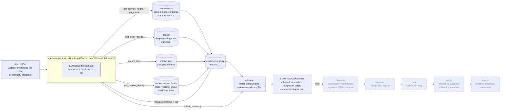

# Incident Zero: architecture

An AI on-call engineer for the OpenTelemetry demo. An alert starts an agent that chooses which
read-only tool to call next. Every observation is registered as evidence with an ID. Checkpoint 1
ends with a validated **symptom summary**: affected services, anomalies with numbers, the suspected
origin, and the evidence IDs behind each claim. Diagnosis, approval, action, verification and the
report come next.



## How it works
- **Sources.** Every tool reads through one interface. `live` uses Prometheus, Jaeger and the
  docker CLI. `fake` uses JSON fixtures shaped exactly like those API responses
  (`tests/fixtures/<scenario>/`). `bundle` replays a recorded live run.
- **Small results.** Tools return summarised dicts of at most about 2 KB: worst services first,
  grouped log patterns, the trace origin, never raw dumps.
- **Evidence.** Each tool registers what it saw and returns IDs. Missing signals count too, such
  as "no recent payment traces". The summary may cite only those IDs; anything else is dropped
  and reported.
- **Origin, not the loudest victim.** Trace analysis follows the call chain to the deepest failing
  span. A failed client call with no server span means the callee never answered.
- **Hard rules in code.** A guard blocks flagd URLs and ports, flag files and flag containers.
  All tools are read-only. The `STOP` file halts the agent. The fault injector
  (`scripts/incident.py`) lives outside the agent package, and a test ensures the agent never
  references it.

## Running
```
pip install -r requirements.txt
python -m pytest -q                                                    # all tests, no demo needed
python -m oncall.agent.run tests/fixtures/payment_down/alert.json --source fake
python -m oncall check                                                 # live endpoints (read-only)
python -m oncall baseline                                              # while healthy
python scripts/demo.py stop-payment                                    # inject, agent, reset
python -m oncall.tools.traces --source fake checkout                   # any tool standalone
```
