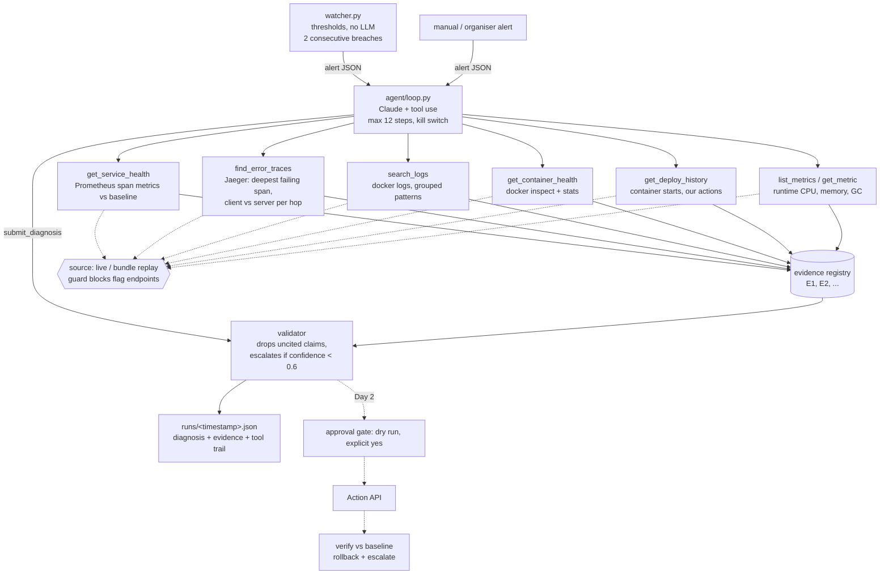

# Incident Zero: architecture

An AI on-call engineer for the OpenTelemetry demo. A threshold watcher raises an alert. An LLM agent
then investigates with read-only tools, names the origin and its cause, and backs every claim with
an evidence ID. Day 2 adds the approval gate and the Action API.



## Key decisions
- **Agent picks the next tool.** The model sees only small (≤2 KB) summaries. It starts broad
  (service and container health) and then narrows to traces, logs and metrics of the suspects.
- **No invented evidence.** Every tool registers what it observed and returns IDs. The diagnosis
  can cite only those IDs, and the validator removes any claim without one. A missing signal
  ("no server spans from payment") is registered as evidence too.
- **Origin, not the loudest victim.** Trace analysis returns the deepest failing span and the call
  chain. A failed client call with no server span means the callee is unreachable. A large
  client-minus-server time on an edge means network trouble.
- **Escalating is a valid answer.** Low confidence or weak evidence sets `status: escalate`, with
  findings and next checks for a human.
- **Hard rules in code.** `sources/guard.py` refuses any URL, path or command that touches flagd or
  the flag UI. All tools are read-only. A `STOP` file halts the agent (`python -m oncall stop`).
- **Offline development.** Any live run can be recorded (`--record DIR`) and replayed later
  (`--source bundle --bundle DIR`).

## Running
```
pip install -r requirements.txt
python -m oncall check                        # verify Prometheus, Jaeger, docker (read-only)
python -m oncall baseline --window 5m         # with the demo healthy, before any fault
python -m oncall investigate --service frontend --signal error_rate --value 0.2
python -m oncall watch                        # watcher -> investigation, end to end
python -m oncall.tools.traces checkout        # any tool standalone
python -m pytest -q
```
