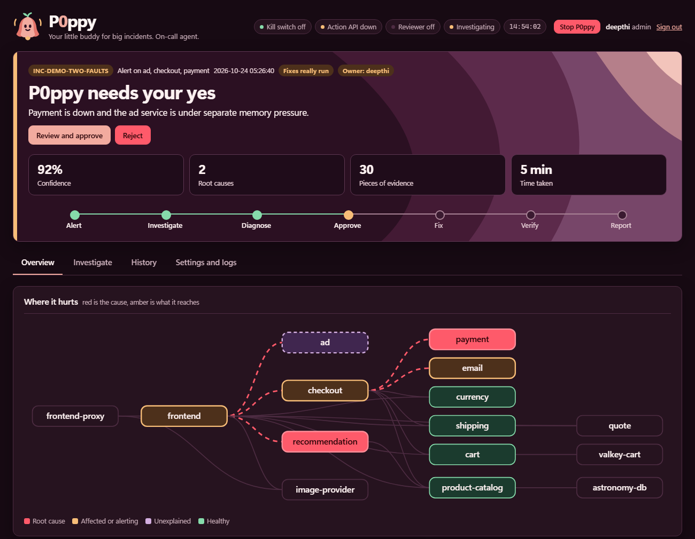
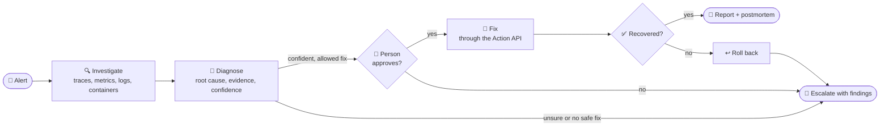

<div align="center">

# P0ppy

### Your little buddy for big incidents

An AI on-call engineer that investigates production incidents with real telemetry,<br>
proves its diagnosis with evidence, and fixes things only after a person says yes.

[](#how-well-it-works)
[](https://www.python.org/downloads/)
[](#how-it-stays-safe)
[](https://github.com/open-telemetry/opentelemetry-demo)
[](LICENSE)

[**Quick start**](#quick-start) · [**How it works**](#how-it-works) · [**Results**](#how-well-it-works) · [**Safety**](#how-it-stays-safe) · [**Architecture**](ARCHITECTURE.md) · [**Evaluation**](EVALUATION.md)

<br>



<sub>The P0ppy dashboard during a sample incident with two root causes (sample data).</sub>

</div>

<br>

## Why P0ppy

When production breaks at 2 a.m., most of the first hour goes on searching: reading logs, checking
dashboards, looking at recent changes and guessing. P0ppy does that first hour. It runs against the
open-source [OpenTelemetry Demo](https://github.com/open-telemetry/opentelemetry-demo), a realistic
microservices shop, and follows one principle:

> **Act when the evidence is there. When it isn't, say "I'm not sure, here is what I found."**

## At a glance

<table>
  <tr>
    <td align="center" width="25%"><h3>3 / 3</h3><sub>different live faults<br>diagnosed correctly</sub></td>
    <td align="center" width="25%"><h3>15 / 15</h3><sub>repeat live runs named<br>the same root cause</sub></td>
    <td align="center" width="25%"><h3>0 / 148</h3><sub>evidence citations<br>that were invented</sub></td>
    <td align="center" width="25%"><h3>32 s</h3><sub>median time from<br>alert to diagnosis</sub></td>
  </tr>
  <tr>
    <td align="center" width="25%"><h3>3 / 3</h3><sub>approved live fixes<br>verified as recovered</sub></td>
    <td align="center" width="25%"><h3>0</h3><sub>changes made without<br>a person's "yes"</sub></td>
    <td align="center" width="25%"><h3>3</h3><sub>unjustified restarts<br>blocked by the validator</sub></td>
    <td align="center" width="25%"><h3>616</h3><sub>automated tests,<br>no Docker or network</sub></td>
  </tr>
</table>

<sub>Counted from 55 saved run records in <code>results/</code>. Details and caveats in <a href="#how-well-it-works">How well it works</a>.</sub>

## How it works



| | |
|---|---|
| **Detects** | Watches error rate, latency and silent services against a recorded healthy baseline |
| **Investigates** | An LLM chooses which traces, metrics, logs and container checks to run next |
| **Proves it** | Every claim must cite evidence P0ppy really collected; anything else is dropped |
| **Handles the messy cases** | Several faults at once, faults it has never seen, and new alerts during a run |
| **Suggests fixes** | Approved actions it can run, listed separately from its own advice, which it never runs |
| **Asks first** | Nothing changes without a person's approval, from the dashboard or the terminal |
| **Verifies** | Compares health against the baseline after a fix, and rolls back if it didn't work |
| **Reports** | A report and draft postmortem for every incident |
| **Alerts** | Email, phone call, Telegram or Slack, routed by severity |

## Quick start

Runs P0ppy on recorded incident data in about 5 minutes. No Docker needed, and nothing is changed.
You need [Python 3.11+](https://www.python.org/downloads/), Git and an LLM key;
[Groq](https://console.groq.com/keys) has a free tier.

```bash
git clone https://github.com/Deepthi2225/incident-zero-oncall-agent.git
cd incident-zero-oncall-agent
python scripts/bootstrap.py          # use python3 on macOS or Linux
```

Open `.env` and set your provider:

```ini
ONCALL_PROVIDER=groq
GROQ_API_KEY=your-key-here
```

Activate the environment (once per terminal), then run an incident:

```bash
.venv\Scripts\Activate.ps1           # Windows PowerShell
source .venv/bin/activate            # macOS or Linux

python -m oncall.agent.run tests/fixtures/payment_down/alert.json --test
```

You'll see each tool it calls, then its diagnosis and proposed fix. The report is saved in `runs/`.
If PowerShell blocks the script, run `Set-ExecutionPolicy -Scope Process RemoteSigned` first.

## Run it for real

Needs [Docker](https://www.docker.com/products/docker-desktop/) with Compose v2, about 6 GB of free
memory and 14 GB of disk. A 16 GB laptop is comfortable.

**1. Start the shop.** Clone it next to this project and keep the folder name, because P0ppy uses it
to recognise the shop's containers. Don't edit anything inside it. If you must use another folder
name, add `COMPOSE_PROJECT=<folder name>` to `.env`.

```bash
cd ..
git clone https://github.com/open-telemetry/opentelemetry-demo.git
cd opentelemetry-demo
git checkout ad06a6f9
docker compose -f compose.yaml -f compose.full.yaml -f compose.observability.yaml up -d
cd ../incident-zero-oncall-agent
```

Wait about 5 minutes for traffic to build up.

**2. Create your account.** The password is typed at a hidden prompt and needs 12 or more characters.

```bash
python -m oncall user add yourname --role admin
```

**3. Record what healthy looks like** while the shop runs normally. This takes about 5 minutes.

```bash
python -m oncall baseline --window 5m
python detector.py --calibrate 300
```

**4. Check that everything is ready.** It tells you exactly what's missing and how to fix it.

```bash
python -m oncall doctor
```

**5. Turn on approvals from the dashboard** by adding `UI_APPROVALS=on` to `.env`.

**6. Start P0ppy:**

```bash
python -m oncall up --watch --execute
```

Open http://127.0.0.1:8090 and sign in. Keep this terminal open; **Ctrl+C** stops everything.
Without `--execute`, approved fixes are a dry run and nothing in the shop changes.

### Try a practice incident

With P0ppy running, break something from a second terminal (activate the environment first):

```bash
python -m faultctl inject stop-payment
```

1. Within about 3 minutes the alert fires. Metrics arrive once a minute, so this delay is normal.
2. P0ppy investigates, and the banner changes to **P0ppy needs your yes**.
3. Click **Review and approve**, check what it will do, and enter your password.
4. P0ppy restarts the service and verifies that it recovered.
5. Open **Investigate** to read the evidence and postmortem.

Put everything back with `python -m faultctl reset`. `python -m faultctl list` shows every practice fault.

## How well it works

We tested P0ppy on faults we injected ourselves: live on one laptop with Claude Opus 5.5 on 23 and
24 October 2026, and later on recorded incidents with other models. Every number is counted from the
55 saved run records in [`results/`](results/), which you can open and check. These are our own
tests, not an independent benchmark; [EVALUATION.md](EVALUATION.md) lists every run.

### Reliability scorecard

| Area | Result | Detail |
|---|---|---|
| Diagnosis accuracy | **3&nbsp;of&nbsp;3** | Different live faults: a stopped service, the cache down, the database down |
| Consistency | **15&nbsp;of&nbsp;15** | Repeat live runs named the same root cause, median confidence 0.90. Twice the alert came from another service and P0ppy still traced it back to the origin |
| Evidence integrity | **0&nbsp;of&nbsp;148** | Citations pointing at evidence P0ppy had not collected |
| Speed | **32&nbsp;s** | Median time from alert to diagnosis, live (range 26 to 62 s) |
| Recovery | **3&nbsp;of&nbsp;3** | Approved live fixes that recovered, confirmed against the baseline in 176 to 280 s |
| Human control | **0** | Unapproved changes. 4 rejected proposals and 4 dry runs changed nothing; all 5 restarts in the Action API log were approved |
| Guardrails | **3** | Restarts the validator blocked because the evidence didn't support them; each became an escalation |
| Kill switch | **1&nbsp;of&nbsp;1** | An already-approved step was refused once the switch was on |
| Unseen faults | **2&nbsp;of&nbsp;2** | Full disk and expired certificate: right origin found, handed to a person instead of guessing a fix |
| Multiple faults | **2&nbsp;of&nbsp;2** | Both causes found when two faults happened at once, each with its own evidence |
| Test environment | **26&nbsp;of&nbsp;26** | Practice faults injected and reset cleanly |
| Cost | **$0.19** | Median model cost per live incident with Claude (range $0.14 to $0.44) |

### How it improved

<table>
  <tr>
    <td align="center"><b>23 Oct</b><br><sub>end of Day 1</sub></td>
    <td align="center"><b>24 Oct</b><br><sub>code freeze</sub></td>
    <td align="center"><b>24 Oct</b><br><sub>end of Day 2</sub></td>
    <td align="center"><b>8 Nov</b></td>
    <td align="center"><b>9 Nov</b></td>
  </tr>
  <tr>
    <td align="center"><h3>106</h3></td>
    <td align="center"><h3>301</h3></td>
    <td align="center"><h3>406</h3></td>
    <td align="center"><h3>484</h3></td>
    <td align="center"><h3>616</h3></td>
  </tr>
</table>

<sub>Automated tests at each milestone, counted with <code>pytest --collect-only</code> on <code>main</code>.</sub>

| | Before | After |
|---|---|---|
| **Automated tests** | 106 at the end of Day 1 | **616** now (301 at code freeze, 406 at the end of Day 2) |
| **Recorded test incidents** | 1, a stopped service | **7**, adding an app error, one broken product, a traffic flood, two faults at once, a full disk and an expired certificate |
| **Scope** | Day 1: diagnose and summarise | The full loop live: diagnose, approve, fix, verify, report, plus a dashboard and alerts |
| **Diagnosis output** | A summary naming a suspected origin | A fault type, a confidence and cited evidence for every cause |
| **Practice faults** | Restart-loop faults did not crash 3 services | Crash confirmed, with a kill-and-start fallback (checked live on payment) |
| **Smaller models** | A confident wrong answer (0.95) that proposed restarting the wrong service | Fallback-assisted diagnoses never offer a fix, and the validator has since turned 3 unjustified restarts into escalations |

### Limits

- **Small sample.** The full loop was proven live on one fault type (a stopped service) and one
  action (restart). These numbers do not predict accuracy on new incidents.
- **Not yet tested live:** memory leaks, CPU pressure, network latency and several faults at once.
  The multi-fault and unseen-fault results come from recorded incidents, and rollback is covered by
  automated tests only.
- **Smaller models are less reliable.** Groq and a local Ollama model got several recorded faults
  right but once gave a confident wrong answer, which is why their diagnoses never offer a fix.

## How it stays safe

| Guardrail | What it means |
|---|---|
| 🔒 **Read-only agent** | Every change goes through the Action API, a separate local service that needs a token |
| ✅ **Allowlisted actions** | Restart a shop service or throttle the load generator. Flag toggling and scaling aren't available, so those faults go to a person |
| 💡 **Advice stays advice** | P0ppy's own suggestions never enter the plan and can never run |
| 🙋 **A person approves every step** | Nobody answering means nothing happens; `--execute` can't be combined with `--auto-approve` |
| 🛑 **Kill switch** | `python -m oncall stop` blocks all model calls, tools and fixes, even approved ones |
| 🧾 **Evidence is checked** | Claims citing evidence that wasn't collected are dropped; weak labels have their confidence capped |
| ↩️ **Recovery is verified** | Health is compared with the baseline after a fix, with rollback and escalation if it failed |
| 📡 **Monitoring is off-limits** | It never touches its own monitoring or anything outside the shop's Compose project |
| 🚫 **No feature-flag data** | Flag settings are never read, and flag data is stripped from all telemetry |
| 🔐 **Locked-down dashboard** | Hashed passwords, roles, login throttling, protected sessions, re-entering your password to approve, an audit log, and it listens only on your machine |
| 🗝️ **Secrets stay out of Git** | `.env`, `escalation.json` and `ui_users.json` are ignored |

## The dashboard

| Tab | What's there |
|---|---|
| **Overview** | The service map, what went wrong, how to fix it, team notes, shop health, who was told |
| **Investigate** | Start a run, see each step P0ppy took, the evidence, the postmortem |
| **History** | Search and filter past incidents |
| **Settings and logs** | Setup check, alert channels, your account, team accounts, logs, the audit log |

| Role | Can do |
|---|---|
| `viewer` | See everything |
| `responder` | Also take ownership, hand over, add notes, start dry-run investigations, verify a manual fix |
| `approver` | Also approve or reject fixes, start live runs, use the kill switch |
| `admin` | Also manage accounts and send test alerts |

## Reference

<details>
<summary><b>Common commands</b></summary>

<br>

| Command | What it does |
|---|---|
| `python -m oncall doctor` | Checks setup and says what to fix |
| `python -m oncall up [--watch] [--execute]` | Starts the Action API and dashboard, and optionally the watcher |
| `python -m oncall stop` / `resume` | Kill switch: blocks all model calls, tools and fixes |
| `python -m oncall investigate --service checkout --signal error_rate` | Investigates by hand (add `--execute` for real fixes) |
| `python -m oncall verify <run_id>` | Checks recovery after you fixed something yourself |
| `python -m oncall ack <incident>` | Acknowledges an incident; with no id, lists those waiting |
| `python -m oncall user add\|list\|remove` | Manages accounts |
| `python -m oncall whoison` | Shows who a rotation has on call today |
| `python -m oncall emailtest` / `calltest` / `telegramtest` / `slacktest` | Sends one labelled test alert |
| `python -m faultctl list` / `inject <id>` / `status` / `reset` | Practice faults |
| `python -m pytest -q` | Runs the tests; they need no key, Docker or network |

</details>

<details>
<summary><b>LLM providers</b></summary>

<br>

All settings go in `.env`, which Git ignores. [.env.example](.env.example) lists them.

| `ONCALL_PROVIDER` | Default model | Key |
|---|---|---|
| `anthropic` (default) | `claude-opus-5-5` | `ANTHROPIC_API_KEY` |
| `groq` | `openai/gpt-oss-120b` | `GROQ_API_KEY` |
| `gemini` | `gemini-3.5-flash-lite` | `GEMINI_API_KEY` |
| `ollama` | `qwen3:8b` | None; runs on your machine |

To use a local model if your main provider fails, install [Ollama](https://ollama.com), run
`ollama pull qwen3:8b`, set the environment variable `OLLAMA_CONTEXT_LENGTH=16384`, and add
`ONCALL_FALLBACK_PROVIDER=ollama`. It needs about 8 GB of GPU memory. **A diagnosis the fallback
helped produce never offers a fix**, because the smaller model is less reliable.

`ONCALL_REVIEWER=on` adds a skeptical second opinion, which can lower confidence or remove steps but
never add them.

</details>

<details>
<summary><b>Alerts: email, phone, Telegram, Slack</b></summary>

<br>

All alerts are off by default, and runs on recorded data never ring anyone.

| Channel | Add to `.env` | Test |
|---|---|---|
| Email (SMTP) | `EMAIL_ENABLED=on`, `SMTP_HOST`, `SMTP_PORT`, `SMTP_USER`, `SMTP_PASSWORD`, `SMTP_STARTTLS=on`, `EMAIL_FROM`, `EMAIL_TO` | `emailtest` |
| Email (Resend) | `EMAIL_ENABLED=on`, `EMAIL_TRANSPORT=resend`, `RESEND_API_KEY`, `EMAIL_TO` | `emailtest` |
| Phone (SEV1, SEV2) | `CALLS_ENABLED=on`, `TWILIO_ACCOUNT_SID`, `TWILIO_AUTH_TOKEN`, `TWILIO_FROM_NUMBER`, `ONCALL_PRIMARY_PHONE` | `calltest` |
| Telegram | `TELEGRAM_ENABLED=on`, `TELEGRAM_BOT_TOKEN`, then message your bot and run `telegramtest` to get `TELEGRAM_CHAT_ID` | `telegramtest` |
| Slack | `SLACK_ENABLED=on`, `SLACK_WEBHOOK_URL` | `slacktest` |

Twilio trial accounts can only call verified numbers. The spoken summary passes through Twimlets,
Twilio's free text-to-call page.

To alert different people by severity, copy `escalation.example.json` to `escalation.json` and fill
it in. It also supports on-call rotations and escalating when nobody acknowledges in time. Anything
missing falls back to `.env`, and test runs only ever reach the `.env` contacts.

</details>

<details>
<summary><b>Use it from your phone</b></summary>

<br>

[Tailscale](https://tailscale.com) gives your own devices a private, encrypted way in, without
putting the dashboard on the internet.

1. Install Tailscale on your computer and phone, and sign in to both with the same account.
2. In the [admin console](https://login.tailscale.com/admin/dns), turn on MagicDNS and HTTPS Certificates.
3. Run `tailscale serve --bg 8090`. It prints an address like `https://your-laptop.your-tailnet.ts.net`.
4. Add `UI_ALLOWED_HOSTS=your-laptop.your-tailnet.ts.net` to `.env`, then restart P0ppy.

Your computer has to be on, with P0ppy running. Use 2-step verification on your Tailscale sign-in
account, and never use `tailscale funnel`, which would make it public. To remove the link:
`tailscale serve --https=443 off`.

</details>

<details>
<summary><b>Troubleshooting</b></summary>

<br>

Start with `python -m oncall doctor`.

| Problem | Fix |
|---|---|
| `python` is not found (macOS or Linux) | Use `python3`, or activate the environment |
| `No module named ...` | Activate the environment, or run `python scripts/bootstrap.py` |
| Stuck on the sign-in page saying no accounts exist | Run `python -m oncall user add yourname --role admin` |
| Run ends with `llm_error` | Run `python scripts/llm_check.py`, then check the key and `ONCALL_PROVIDER` |
| Groq rate limits | The free tier is limited per day; add the Ollama fallback or wait |
| No metrics or an empty report | Metrics arrive about once a minute, so wait 2 to 3 minutes |
| A fix says "dry run" | Start with `--execute` |
| Nothing to approve on the dashboard | Add `UI_APPROVALS=on` to `.env` and restart |
| "Port is already in use" from `up` | P0ppy is already running; close the other terminal |
| Actions refused as outside the project | Set `COMPOSE_PROJECT` to the shop's folder name |
| Agent says the kill switch is on | Run `python -m oncall resume` |
| Docker runs out of memory | Give Docker at least 6 GB in its settings |

</details>

## Learn more

- [ARCHITECTURE.md](ARCHITECTURE.md): the design
- [EVALUATION.md](EVALUATION.md): every run and how the numbers were counted
- [`results/`](results/): saved run records, including several faults at once and unseen faults

## Contributors

P0ppy began as **Incident Zero**, a team project at the Bosch AI hackathon at PES University in
October 2026 ([original repository](https://github.com/aniruddhajoshi100/ocAgent)), and is now
continued by Deepthi.

| | |
|---|---|
| **Deepthi** | [@Deepthi2225](https://github.com/Deepthi2225) |
| **Aniruddha Joshi** | [@aniruddhajoshi100](https://github.com/aniruddhajoshi100) |
| **Shivakumar** | [@ShivakumarSK2005](https://github.com/ShivakumarSK2005) |
| **Padma** | |
| **Nirupam** | |

## License

Released under the [MIT License](LICENSE).
